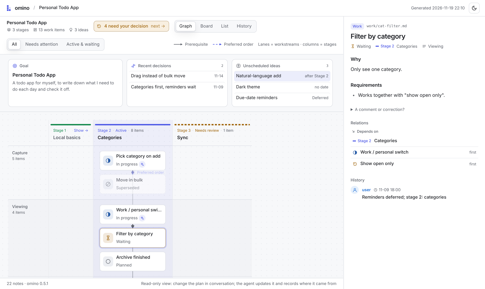
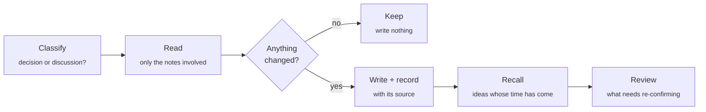
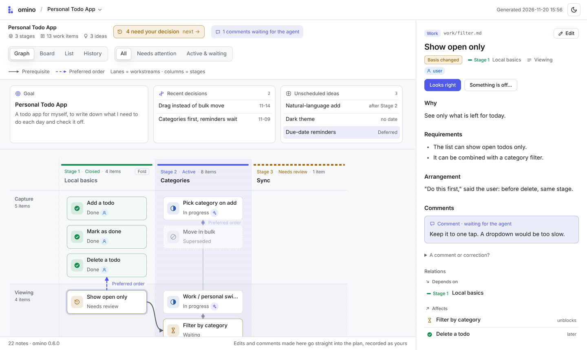

<div align="center">

<picture>
  <source media="(prefers-color-scheme: dark)" srcset="assets/logo-dark.svg">
  
</picture>

<h1>omino</h1>

<p><b>One structured document that keeps growing.</b><br>It captures every plan, request and decision you make.</p>

<p>Each new piece of work attaches to the same plan instead of starting a new doc. Omino keeps track of what comes first, what has to wait and what can run in parallel.<br>Your coding agents work from it, and you can open it any time to see where things stand.</p>

<p>
  
  
  
  
</p>

<p>
  <a href="https://omino.mandala.pub/">Website</a> ·
  <a href="https://github.com/maktub-ai/omino">Star on GitHub</a> ·
  <a href="#quick-start">Quick start</a> ·
  <a href="#how-it-works">How it works</a> ·
  <a href="#commands">Commands</a> ·
  <a href="#faq">FAQ</a> ·
  <a href="README.zh-CN.md">简体中文</a>
</p>

</div>

<picture>
  <source media="(prefers-color-scheme: dark)" srcset="assets/screenshot-dark.png">
  
</picture>

---

## The problem

With coding agents, every new task starts with a fresh plan, spec or design note, written for that one change. A few weeks later:

- **No order.** You can't tell which doc was implemented first.
- **Overlap.** The same thing is described in several docs, each a little differently.
- **Quiet conflicts.** A later request overrode an earlier one, but the old doc is still there, and the next agent may read it.
- **Hard to read afterwards.** Useful at the time; later it's a pile of files that don't add up to a picture of the project.

Every new session, you explain it all again. Every agent rebuilds its own picture. Nobody can see the whole thing.

## What omino does

Omino keeps a small, living plan for your project — one copy per project on your machine, shared by every worktree and branch. Your agent reads it before acting and updates it when — and only when — something real changes. You read it any time, as a page you can actually understand.

It is built on a few strict ideas:

| | |
|---|---|
| 🧩 **Decisions, not chatter** | Questions, brainstorming and "what ifs" never change the plan. Only intent, arrangement and progress do. |
| ↔️ **Order is not dependency** | "Do A first" is a preference. "B can't start until A" is a prerequisite. They are stored — and drawn — differently. |
| ✅ **Every "done" has a source** | The user said it, an agent said it, or a tool proved it. You can always tell which. |
| 🔔 **Ideas come back — once** | Park an idea with a condition. It is raised when the condition holds, never adopted on its own, and never nagged about after you decide. |
| 🔁 **Changed requirements are flagged** | Each completion remembers what it was measured against. When that changes, the item is listed for re-confirmation instead of silently staying "done". |
| 🧭 **Changes of direction are remembered** | When strategy changes, a decision records what was replaced and why. The old plan stays visible as superseded, so nobody re-proposes it without knowing why it was dropped. |
| 🔗 **Every change is traceable** | Each history entry keeps the user's words, the git branch / commit / worktree, and optionally the conversation id. |

Omino is **not an agent** and **does not run tasks**. It is a file format, a skill that teaches agents to keep it, and a viewer that lets you read it.

## Quick start

Requires Node 18+. No dependencies.

**See it first** — the sample plan is in the repository with its page already built:

```sh
git clone https://github.com/maktub-ai/omino.git
open omino/examples/todo-app-en/view.html      # macOS; use xdg-open on Linux
```

### Install for your agent

**Skill only (Skills CLI)** — install the skill without lifecycle hooks. For hooks in Codex or Claude Code, use the matching plugin below.

```sh
npx skills add maktub-ai/omino
```

**Codex** — add the project's GitHub marketplace and install the plugin from it:

```sh
codex plugin marketplace add maktub-ai/omino
codex plugin add omino@omino
```

Start a new Codex session and open `/hooks` to review and trust Omino's lifecycle hooks. Only trusted hooks run.

**Claude Code** — or install the plugin. It brings the skill, the hooks and the six commands, spelled `/omino:plan` and so on (Claude Code adds the plugin's name to every plugin command):

```
/plugin marketplace add maktub-ai/omino
/plugin install omino@omino
```

Both plugins are distributed through Omino's public GitHub marketplace, not the platforms' official plugin directories.

**Gemini CLI, Kimi Code CLI and other agents** — clone Omino and run its skill installer with Node.js 18 or newer. It puts the skill where supported agents look for it (including `~/.agents/skills/`). Omino is not currently published on npm.

```sh
git clone https://github.com/maktub-ai/omino.git
node omino/skills/omino/scripts/omino.mjs install
```

The first time the agent uses it, it offers `omino setup`, which adds the hooks only for the agent you are using, to `~/.gemini/settings.json` or `~/.kimi-code/config.toml`. Kimi has no session-start context, so the brief arrives with your first message instead.

Then just talk about your project. Type `/omino-plan` (or say you want to keep a plan) to start one; the agent never starts one on its own. You never run Omino commands yourself: when something needs setting up on your machine — hooks, permissions, a plan from an older version — the agent says what will change, asks once, and does it.

### DeepSeek Harness (DSH)

DSH discovers the installed Omino skill in `~/.agents/skills`. Enable the native Omino hooks on a DSH invocation with `--patch ~/.agents/skills/omino/scripts/dsh.patch.yml`. To enable them for all profiles (including Mandala’s ACP connection), add this entry to the patch list in `$DSH_HOME/cordis.patch.yml` (`~/.dsh/cordis.patch.yml` by default) and restart DSH. Replace the path with the absolute path to the installed Omino skill’s script.

```yaml
- insert:
    - id: omino
      name: /absolute/path/to/omino/scripts/dsh.mjs
```

Omino loads the plan for the session’s workspace on the first prompt, then relays new page replies and reminds the agent to record significant changes when needed. DSH’s native model and provider settings apply.

### What it puts on your machine

- **The plans:** `~/.omino/projects/<id>/` — Markdown notes, an append-only history, and the folder's own git history (one commit per change). Every worktree and clone of a project shares one plan.
- **In your repository:** nothing by default. The link to the plan stays in `.git` on your machine; for your own repository you can share it as a committed `.omino.json`.
- **Agent settings:** only with your yes — hooks, and permission for the agent to write to `~/.omino`.
- **A local page service:** serves the editable plan page on `127.0.0.1:4870` only, with a token required for writes. The hooks start it; it can also start when you log in (the agent asks you once).

## How it works

Every turn, the skill reads the conversation through three lenses — **intent** (why), **arrangement** (what, when, in what order) and **progress** (what actually happened, and who says so) — and follows one loop:



The judgement calls are the agent's. Everything that can be computed — validation, history, recall conditions, what's stale — is done by a small deterministic CLI, so it doesn't depend on the model getting arithmetic right.

### The plan on disk

Plans live in `~/.omino/projects/<id>/`, not in your working tree. Every worktree and clone of a project shares that one copy, so parallel branches never fight over plan files, and the page shows the same plan wherever you open it. The folder is its own git repository — one commit per `record` — so the plan has full history without touching your project's commits. By default Omino adds nothing to your repository: the link to the plan stays in `.git` on your machine. For your own repository you can share it as `.omino.json` (`{"project": "<id>"}`), committed so every clone finds the same plan; a team repository or a fork keeps your plan to yourself. A plan is one line of work with one goal: a product spread over several repositories is one plan with a lane per repository; a piece of work inside a team repository is a plan of its own, closed when done. `omino where` prints the folder; `omino migrate` moves a plan from the old in-repo `.omino/` layout.

```
~/.omino/projects/acme-todo-app/
├── project.md        # the goal: what this plan should achieve, its principles and boundaries
├── stages/s1.md      # stages, in the order you advance through them
├── work/filter.md    # one note per piece of work
├── ideas/remind.md   # parked ideas, with recall conditions
├── decisions/        # changes of direction: before, now, why, what was given up
├── changes.jsonl     # append-only history: what changed, when, by whose word
└── state.json        # fingerprints, so direct edits are noticed
```

Each note is plain Markdown with a little frontmatter. You can read and edit it in any editor:

```markdown
---
id: filter
kind: work
title: Show open only
stage: s1
lane: Viewing
status: done
source: user
before: [del]
---

## Why
See only what is left for today.

## Requirements
- The list can show open todos only.

## Arrangement
"Do this first," said the user: before delete, same stage.
```

### Four relations, never confused

| Relation | Field | Blocks work? |
|---|---|---|
| Belongs to a stage or goal | `stage`, `parent` | no |
| Prerequisite | `requires` | **yes** |
| Preferred order | `before` | no |
| Context | `refs` | no |

No recorded prerequisite does **not** mean two items can safely run in parallel — and omino never says it does.

## Six moves you can ask for

Most of the time you just talk and the agent decides, turn by turn. When you want one move on purpose, type it. The names come from falling-block games.

| You type | Move | What happens | Changes the plan |
|---|---|---|---|
| `/omino-plan` | start | Start a plan, or work on it as a whole: goal, stages, lanes, order | yes |
| `/omino-next` | next queue | What can start, what is blocked and on what, what waits for you | no |
| `/omino-ghost` | ghost piece | Where new work would go (stage, lane, prerequisites), as a draft for you to confirm | a draft |
| `/omino-lock` | lock | Turn what you discussed into a decision: what it replaces, why, what is given up | yes |
| `/omino-hold` | hold | Park an idea with a condition for bringing it back | yes |
| `/omino-clear` | line clear | Wrap up a stage: confirm what is done, settle what needs review, close it | after you confirm |

After running the skill installer they are `/omino-plan` and so on in Claude Code and `$omino-plan` in Codex; with the Claude Code plugin they are `/omino:plan` and so on.

## Commands

The agent runs these; you can too. All accept `--dir <project>` and `--json`.

| Command | What it does |
|---|---|
| `omino init [--adopt]` | Start a plan. `--adopt` is for projects that already exist (see below). |
| `omino record "<summary>" --source user\|agent\|tool\|file [--said "…"] [--session id]` | Record every changed note as one history entry, with the user's words and the git branch / commit / worktree. Flags work a new decision affects. Refreshes the page and prints a link to each changed note. |
| `omino check [--fix]` | Validate notes and references, detect cycles, list ideas and decisions tied to nothing. `--fix` records edits you made directly to the files. |
| `omino find <words>` | Search the plan, so the agent links to an existing note instead of adding a duplicate. |
| `omino brief` | A ten-line summary for the start of a session. |
| `omino recall` | List parked ideas whose condition is now met. |
| `omino review` | List what needs a human: flagged items, changed requirements, unconfirmed "done", recalled ideas, open questions, waiting work. |
| `omino view [--open]` | Write a read-only, self-contained HTML page of the plan (works offline); `--open` opens the plan's editable page on the page service. |
| `omino service status` · `start` · `stop` · `install` · `uninstall` | The page service: every plan on this machine at `http://127.0.0.1:4870/p/<id>`. Hooks start it; `install` also starts it when you log in. |
| `omino init --name <id> [--share]` | Name a new plan after what it is for; `--share` also writes `.omino.json` for your own repository (otherwise the link stays on this machine) |
| `omino lane "<name>"` | The lane this repository's work goes into, when one plan spans several repositories |
| `omino close [--reopen]` | Mark a plan finished: it stays readable and no longer changes; the next piece of work in the folder gets its own plan |
| `omino projects --open` | One page with every plan on this machine: goal, progress, what waits for you, repositories |
| `omino where` · `projects` · `link <id>` | Print this project's plan folder; list every plan on the machine with its repositories; point this project at an existing plan (share one plan between repositories, or fix a wrong match) |
| `omino setup [--dry-run]` | Everything this machine needs for the project in one step the user approves: move an old plan out, write `.omino.json`, let agents write to the plan folder, update older skill copies. The agent runs it |
| `omino migrate` · `allow` | The single steps of `setup` |
| `omino doctor` | Check Node, the plan's format, hooks and the AGENTS.md line. Changes nothing. |
| `omino hooks install` · `remove` · `status` | Add the hooks to Claude Code settings when you don't use the plugin. |

`omino` here means `node skills/omino/scripts/omino.mjs`.

## When the direction changes

Plans don't only grow; they turn. When you say "drop bulk move, dragging is enough", the agent writes a **decision**: what was planned before, what now, why, what was given up. The replaced item stays on the plan, struck through, linked to the decision. Work already under way that the decision may affect is flagged for a second look. Next session, the agent reads recent decisions first — so it won't bring back what you already ruled out.

Every history entry also records where the work was (git branch, commit, worktree) and, when known, which conversation it came from.

## Read, edit and comment on the page

Every plan on your machine has a page at `http://127.0.0.1:4870/p/<id>` — the agent gives you the link, and `http://127.0.0.1:4870` lists them all. A small local service serves them; the hooks start it, and it can start when you log in (the agent asks you once).

<p align="center"></p>

- **Edit** any note — its Markdown, right there. Saving writes the file and records the change as yours. If the agent changed the note while you were editing, you're told before anything is overwritten.
- **Confirm** what waits for you — a draft, work the agent reported done, finished work whose requirements changed. One click, recorded as yours.
- **Comment** — answer an open question, say something is off, adopt or drop a recalled idea, or just leave a remark. A comment is a short block under the note's `## Comments`; the agent sees it with your next message, does what it asks, and removes it.

Nothing on the page waits for the agent, and nothing needs to be listening: the page writes the files, and the agent reads them. When the agent records a change, open pages refresh by themselves. Everything stays on 127.0.0.1; only pages from this service can write (the Host header is checked and the write API needs a token kept in `~/.omino/server.json`).

`view.html` in the plan folder is the same page, read-only — for opening without the service, or in a sandbox. When the service runs, it links to the editable page.

**Without being asked.** In a project with a plan, the hooks keep it current on their own: when you hand the agent a task, it registers it in the plan as in progress before starting (no breakdown unless you ask), and marks it done when finished. In a git project without a plan, Omino stays silent until a turn changes the project substantially; then the agent asks you once whether to keep a plan there, and never again.

## Reviewing changes happens in the conversation

The page is for reading, like a notes app — not a diff tool. When your agent changes the plan, it tells you in the chat which notes it added or changed, each with a link straight to that note. If the change is something you just decided, that's it. If the agent drafted it (an intent, a breakdown of work, requirements), it is marked for review until you say it's fine — and only then does work start. Every history entry keeps the words you said, so each change traces back to a moment in a conversation.

## Adopting an existing project

Starting omino on a project that's been going for months? `init --adopt` begins the plan **now**, without inventing the past:

- the agent tells you which files it added and opens the plan for you;
- it drafts the project intent from your README and a handful of top-level docs — **flagged** until you confirm it;
- where your docs disagree, it doesn't pick a side: each conflict becomes an **open question** for you;
- what already exists is summarised once, in a closed "Before Omino" stage;
- past features are **not** back-filled as completed work (nobody recorded what they were measured against);
- existing to-dos come in as unscheduled ideas, only if you want them;
- the plan grows as your conversations touch new areas.

The first time we did this on our own project, [Mandala](https://github.com/maktub-ai/mandala), the first thing it surfaced was where older docs disagreed.

## The viewer

`omino view` writes one HTML file — no server, no network:

- **The plan first** — stages as columns, workstreams as lanes, ideas below; prerequisites, preferred order and recall drawn as different lines.
- **Decisions only when there are any** — a small "N need your decision" button appears when something waits on you and walks you through the items, opening each note. When nothing waits, it isn't there.
- **The note** — the full text, its relations and its history.
- **History** — the change log, each entry tagged user / agent / tool / file, with the user's own words that led to it.
- **Links to any note** — `view.html#<note id>` opens that note directly.

Ways to look at the same plan: **Graph** (stages × workstreams with relations), **Board** (columns by status), **List** (a table grouped by stage) and **History**. All are views of the same files.

Light and dark, English and Chinese. Drag the panel edges to resize them.

## FAQ

**Is omino an agent?** No. It's a format plus instructions. Your agent does the work; omino keeps the shared understanding.

**Which agents does it work with?** Anything that can read a skill folder and run a Node script. Claude Code, Codex, Gemini CLI and Kimi Code CLI get the full set, hooks included.

**Does it run on Windows?** It is built and tested on macOS and Linux. The code avoids shell-specific commands (hooks are plain `node "…" hook …` there, and the page opens with `start`), but it has not been tried on a Windows machine yet — reports are welcome. Other agents can follow `SKILL.md`; automatic upkeep depends on the agent loading the skill.

**Can I edit the plan by hand?** Yes — on the page (recorded as yours at once), or in any editor: notes are Markdown, and `omino check --fix` records such an edit with source `file`.

**Why files and not a database?** Files diff, review and travel with your repo. The frontmatter is a strict subset so the CLI needs zero dependencies.

**Multiple agents at once?** Not supported yet. For now Omino assumes one person and one agent working in turn.

## Roadmap

- [x] v0: format, skill, CLI, viewer (graph, board, list), adopt flow, seven-turn test scenario
- [x] v0.2: decisions (supersedes / affects), provenance (user's words, git, session), links to notes
- [x] v0.3: answer questions, confirm, decide and comment on the page
- [x] v0.4: Claude Code plugin with hooks (session brief, page answers, record reminder), `find`, `brief`, `doctor`, unlinked-note checks, format version
- [x] v0.5: one shared plan per project outside the working tree (`~/.omino`), with its own history; `where`, `migrate`, `allow`, `setup`; hooks for Codex too; a viewer redrawn with icons and stage tracks
- [x] v0.5.1: what a plan is for — goals, `init --name`, links kept local unless shared, lanes per repository, `close`, an overview of every plan; one writer at a time
- [x] v0.6: one page service for every plan on the machine — edit notes, confirm and comment on the page; no agent needs to be listening
- [x] 1.0: public release — six commands (`/omino-plan` … `/omino-clear`), the skill installer, the Claude Code and Codex plugins, hooks for Kimi Code CLI and Gemini CLI
- [ ] Next: sync — share a plan between machines and people (a git remote first, then a small self-hosted server)

## Development

```sh
npm test              # 79 tests, node:test, no dependencies
npm run fixtures      # rebuild tests/fixtures and examples/
```

- `tests/scenario.mjs` replays a seven-turn conversation as file edits and commands; every turn's resulting `.omino/` is in `tests/fixtures/todo/r1 … r7`.
- `evals/behavior.md` lists hand-run checks of agent behaviour — the part tests can't cover.
- `docs/dev/v0.md` is the development spec (Chinese).

Omino is early. Issues and ideas are very welcome; please open an issue before a large pull request.

## The name

From *-omino*, as in polyomino and tetromino: a shape made of squares. Work arrives like falling pieces; a good plan is where each one fits. (In Italian, *omino* also means "little man".)

## License

[MIT](LICENSE)
