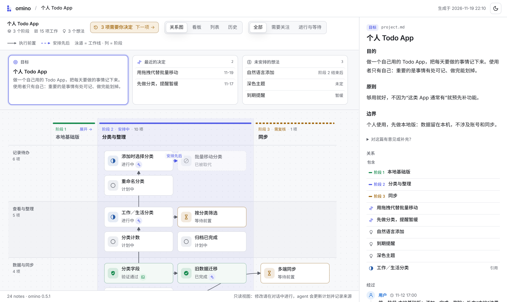
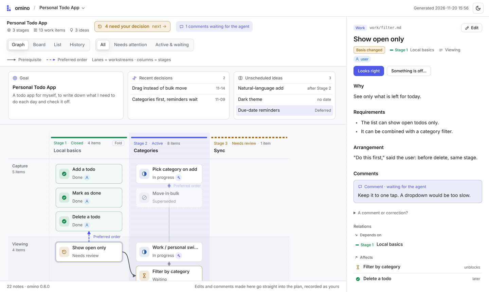

<div align="center">

<picture>
  <source media="(prefers-color-scheme: dark)" srcset="assets/logo-dark.svg">
  
</picture>

<h1>omino</h1>

<p><b>一份持续生长的结构化文档。</b><br>抓住你的所有计划、需求与决定。</p>

<p>新的工作挂到同一份计划上，不再每次新写一份文档。Omino 记下哪件先做、哪件要等、哪些可以并行。<br>你的 coding agent 照着它做，你随时打开就能看到进展。</p>

<p>
  <a href="#快速开始">快速开始</a> ·
  <a href="#怎么工作">怎么工作</a> ·
  <a href="#命令">命令</a> ·
  <a href="#常见问题">常见问题</a> ·
  <a href="README.md">English</a>
</p>

</div>



---

## 要解决的问题

用 coding agent 做事，每个新任务都会先写一份新的计划、spec 或设计说明，每份都只为那一次改动服务。过几周再看：

- **分不清先后**：哪份先实现、哪份后实现，已经说不清。
- **内容重叠**：同一件事在好几份文档里各写一遍，写法还不一样。
- **冲突没人发现**：后来的需求推翻了前面的，旧文档却还在，下一个 agent 可能读到的就是它。
- **事后读不懂**：当时有用，回头看是一堆零散的文件，拼不出项目的全貌。

每开一次新会话，你都要重新解释一遍；每个 agent 都在自己重建上下文；没有人能看到全貌。

## omino 做什么

omino 为你的项目维护一份活的计划：每个项目在本机只有一份，所有 worktree 和分支共用。agent 在行动前读它，并且**只在真的有变化时**更新它。你随时可以把它当成一个看得懂的页面来读。

| | |
|---|---|
| 🧩 **只记决定，不记闲聊** | 提问、讨论、假设都不会改计划，只有意图、安排和进展会。 |
| ↔️ **先后不等于依赖** | “先做 A”是偏好，“B 必须等 A 做完”是前置条件，两者分开存、分开画。 |
| ✅ **每个“完成”都有来源** | 用户说的、agent 说的、还是工具证明的，一眼就能分清。 |
| 🔔 **想法会在对的时候回来，只回来一次** | 暂存的想法带着召回条件；条件成立时带回讨论，不自动采纳，你决定后也不会反复提醒。 |
| 🔁 **需求变了会被标出来** | 每个完成都记得它当时依据的要求；要求一改，就进入“需复核”，而不是静静地保持“已完成”。 |
| 🧭 **记得为什么换了打法** | 策略改变时写下一条“决定”：取代了什么、为什么、放弃了什么。旧方案保留并标为已被取代，不会被不明就里地重新提出。 |
| 🔗 **每次变化都能追溯** | 每条历史记下你的原话、git 分支 / 提交 / worktree，能拿到时还有会话 id。 |

omino **不是 agent**，也**不执行任务**。它是一种文件格式、一份教 agent 维护它的 skill，加上一个让人阅读的页面。

## 快速开始

需要 Node 18 以上，没有其他依赖。

**先看看效果**：示例计划和生成好的页面就在仓库里：

```sh
git clone https://github.com/maktub-ai/omino.git
open omino/examples/todo-app/view.html      # macOS；Linux 用 xdg-open
```

### 给你的 agent 装上

**Claude Code**：也可以安装插件，skill、hook 和六个命令一起装好，命令写作 `/omino:plan` 这样（Claude Code 会给插件命令加上插件名）：

```
/plugin marketplace add maktub-ai/omino
/plugin install omino@omino
```

**Codex**：同一个仓库也是 Codex 插件（`.codex-plugin/`），用的是同一套 hook；Codex 会让你在 `/hooks` 里批准一次。

**Gemini CLI、Kimi Code CLI 和其他 agent**：一条命令把 skill 放进本机各个 agent 读取 skill 的目录（包括多个工具共用的 `~/.agents/skills/`），用你手边的包管理器即可：

```sh
npx omino install          # npm
pnpm dlx omino install     # pnpm
bunx omino install         # bun
yarn dlx omino install     # yarn
```

agent 第一次用到时会提出运行 `omino setup`，只给你正在用的 agent 加 hook，写进 `~/.gemini/settings.json` 或 `~/.kimi-code/config.toml`。在 Codex 里用不会问 Gemini、Kimi 的事。Kimi 在会话开始时不接收上下文，所以计划摘要会随你的第一条消息一起送达。

然后照常聊你的项目。输入 `/omino-plan`（或者说你想记个计划）就会开始，agent 不会自己开始一份计划。你不需要自己跑任何 Omino 命令：需要在本机做设置时（hook、写入权限、旧版本的计划），agent 会说明要改什么，问你一次，然后自己完成。

### DeepSeek Harness（DSH）

DSH 会从 `~/.agents/skills` 读取已安装的 Omino 技能。单次启用原生 hook 时，为 DSH 加上 `--patch ~/.agents/skills/omino/scripts/dsh.patch.yml`。要在所有 profile 中启用（含 Mandala 的 ACP 连接），将下面的条目加入 `$DSH_HOME/cordis.patch.yml`（默认 `~/.dsh/cordis.patch.yml`）的补丁列表，重启 DSH。把路径替换为已安装的 Omino 技能脚本的绝对路径。

```yaml
- insert:
    - id: omino
      name: /absolute/path/to/omino/scripts/dsh.mjs
```

Omino 会在首条消息时载入会话工作目录的计划，转交新留言，并在需要时提醒 agent 记录进度。模型和服务由 DSH 的原生配置决定。

### 它在你的机器上放了什么

- **计划：** `~/.omino/projects/<id>/`，里面是 Markdown 笔记、只追加的变化记录，以及这个目录自己的 git 历史（每次变化提交一次）。同一个项目的所有 worktree 和 clone 共用一份计划。
- **你的仓库里：** 默认什么都不放。关联只记在本机的 `.git` 里；自己的仓库可以选择写一个 `.omino.json` 并提交。
- **agent 的设置：** 只在你同意后才改：hook，以及允许 agent 写 `~/.omino`。
- **一个本地页面服务：** 提供可编辑的计划页面，只监听 `127.0.0.1:4870`，写接口需要访问令牌。hook 会启动它；也可以让它开机登录后自动启动（agent 会问你一次）。

## 怎么工作

每一轮，skill 都从**意图、安排、进展**三个角度理解对话，然后：判断这是决定还是讨论 → 只读相关的笔记 → 有变化才写入并记录来源 → 检查有没有该召回的想法 → 检查有没有需要重新确认的结论。

需要判断的部分交给 agent；能计算的部分（校验、历史、召回条件、哪些结论过期）交给一个零依赖、结果确定的脚本。

计划放在 `~/.omino/projects/<id>/`，不在工作目录里：同一个项目的所有 worktree 和 clone 共用这一份，并行分支不会在计划文件上冲突。这个目录本身是一个 git 仓库，每次 `record` 提交一次，计划有完整历史，又不混进项目的提交。默认不往仓库里加任何文件，关联只记在本机的 `.git` 里；自己的仓库可以选择写 `.omino.json` 并提交，团队仓库和 fork 里的计划只属于你自己。一份计划是一条有目标的工作主线：跨多个仓库的产品是一份计划、每个仓库一条泳道；团队仓库里自己负责的一件事是一份单独的计划，做完就结束。`omino where` 输出目录位置；旧版放在仓库里的 `.omino/` 用 `omino migrate` 迁移。

计划就是这个目录下的 Markdown 笔记：`project.md`（目标）、`stages/`（阶段）、`work/`（工作项）、`ideas/`（暂存的想法），以及只追加的 `changes.jsonl`（变化记录）。任何编辑器都能直接读和改。

## 六个可以直接叫的动作

大多数时候你只管聊，agent 每一轮自己判断。想明确做某一步时，直接输入命令。名字取自方块游戏里的动作。

| 输入 | 动作 | 会发生什么 | 改不改计划 |
|---|---|---|---|
| `/omino-plan` | 开局 | 开始一份计划，或者整体整理：目标、阶段、泳道、顺序 | 改 |
| `/omino-next` | 预览队列 | 什么能开工、什么被卡住、卡在哪、什么在等你 | 不改 |
| `/omino-ghost` | 落点虚影 | 新的工作会放在哪（阶段、泳道、前置条件），先作为草稿等你确认 | 写草稿 |
| `/omino-lock` | 落地锁定 | 把刚才讨论的定下来，记成决定：取代了什么、为什么、放弃了什么 | 改 |
| `/omino-hold` | 暂存 | 把一个想法先放着，带上什么时候拿回来的条件 | 改 |
| `/omino-clear` | 消行 | 收尾一个阶段：确认完成、处理需复核的事、关掉这个阶段 | 你确认后改 |

用 `npx omino install` 安装后，Claude Code 里写作 `/omino-plan`，Codex 里写作 `$omino-plan`；用 Claude Code 插件时写作 `/omino:plan`。

## 命令

| 命令 | 作用 |
|---|---|
| `omino init [--adopt]` | 开始一份计划；`--adopt` 用于已经开发了一段时间的项目 |
| `omino record "<说明>" --source user\|agent\|tool\|file [--said "原话"]` | 把所有改动记为一条历史并附上用户原话；同时刷新阅读页，输出每篇改动笔记的直达链接 |
| `omino check [--fix]` | 校验笔记和引用、检查成环，列出没有挂到任何地方的想法和决定；`--fix` 把你手动改文件的记录补上 |
| `omino find <关键词>` | 搜索计划，新建前先找有没有现成的笔记 |
| `omino brief` | 会话开始时的十行简报 |
| `omino recall` | 列出条件已经成立的暂存想法 |
| `omino review` | 列出需要人来决定的事 |
| `omino view [--open]` | 生成一个离线可用的只读 HTML 阅读页；`--open` 在本地页面服务上打开这份计划的可编辑页面 |
| `omino service status` · `start` · `stop` · `install` · `uninstall` | 本地页面服务：本机每份计划都在 `http://127.0.0.1:4870/p/<id>`。hook 会启动它；`install` 让它开机登录后自动启动 |
| `omino init --name <id> [--share]` | 按这份计划要做的事起名；`--share` 才在自己的仓库里写 `.omino.json`，否则关联只记在本机 |
| `omino lane "<名字>"` | 一份计划跨多个仓库时，指定当前仓库对应哪条泳道 |
| `omino close [--reopen]` | 计划结束：保留可读，不再修改；同一目录的下一件事开新计划 |
| `omino projects --open` | 本机所有计划的总览页：目标、进度、待你决定的事、对应仓库 |
| `omino where` · `projects` · `link <id>` | 输出计划目录；列出本机所有计划及其仓库；把当前项目指向已有的计划（多个仓库共用一份计划，或纠正认错的项目） |
| `omino setup [--dry-run]` | 本机需要的设置一步完成（由 agent 在你同意后运行）：迁出旧计划、写 `.omino.json`、允许 agent 写计划目录、更新旧的技能副本 |
| `omino migrate` · `allow` | `setup` 里的单个步骤 |
| `omino doctor` | 检查 Node、计划格式版本、hook 和 AGENTS.md 提示；不做任何修改 |
| `omino hooks install` · `remove` · `status` | 不用插件时，把 hook 加进 Claude Code 设置 |

## 接入已有项目

`init --adopt` 让计划从**现在**开始，而不是编造过去：agent 会告诉你新增了哪些文件并打开阅读页；根据 README 和少数几份顶层文档起草项目意图，文档之间互相矛盾的地方不替你选择，而是逐条列为待你回答的问题；在你确认前一直标记为待确认；已有的能力只在一个已结束的“Before Omino”阶段里概括一次；不为过去的功能补建完成记录；已有的 TODO 只有在你同意时才导入，并且作为未安排的想法。

我们第一次在自己的项目 [Mandala](https://github.com/maktub-ai/mandala) 上这样接入时，它找到的第一件事就是旧文档之间说法不一致的地方。

## 阅读页

同一份计划可以用**关系图**、**看板**、**列表**和**历史**四种方式看。有事需要你决定时，顶部才会出现“N 项需要你决定”，点一下逐项跳到对应笔记；没有时它就不出现。`view.html#<笔记 id>` 可以直接打开某一篇。

## 方向改变时

计划不只会变多，也会转向。你说“批量移动不要了，拖过去就行”，agent 会写一条**决定**：原来的安排、现在的安排、原因、放弃了什么。被取代的工作项保留在图上、显示为已被取代，并链接到这条决定；已经在做、可能受影响的工作会被标出来请你再看一眼。下次开会话，agent 先读最近的决定，不会把你已经否掉的方案再提一遍。

## 在页面上阅读、编辑和留言

本机的每份计划都有一个页面：`http://127.0.0.1:4870/p/<id>`，agent 会把链接给你，`http://127.0.0.1:4870` 列出所有计划。页面由一个本地小服务提供，hook 会启动它；也可以让它开机登录后自动启动（agent 会问你一次）。

<p align="center"></p>

- **编辑**：直接改任何一篇笔记的 Markdown。保存就写进文件，并记作你的修改。如果你编辑期间 agent 也改了这篇，会先提示你，不会直接覆盖。
- **确认**：等你确认的事——agent 起草的内容、agent 报告完成的工作、要求变了的已完成工作——点一下就确认，记作你的。
- **留言**：回答待回答的问题、指出哪里不对、采纳或放弃召回的想法，或者随手说一句。留言是笔记里 `## Comments` 下的一小段；agent 会在你下一条消息时看到，照着做完再把它删掉。

页面不需要等 agent，也不需要有人在“监听”：页面直接写文件，agent 读文件。agent 记录了变化，打开着的页面会自己刷新。全程只在 127.0.0.1 上；只有这个服务提供的页面能写（会检查 Host，写接口需要 `~/.omino/server.json` 里的令牌）。

计划文件夹里的 `view.html` 是同一个页面的只读版，用于没有服务或在沙箱里的时候；服务在运行时，它会给出可编辑页面的链接。

**不用你开口。** 有计划的项目里，hook 会自己让计划跟上：你交给 agent 一个任务，它开工前先在计划里登记一行、标成进行中（除非你要求，不会拆解规划），做完标成完成。没有计划的 git 项目里，Omino 平时不出声，等某一轮改动较大时，agent 会问你一次要不要记计划，之后不再问。

## 在对话里确认变化

阅读页像笔记软件，只负责呈现，不做 diff。agent 改了计划，会在对话里告诉你新增或修改了哪几篇，每篇附直达链接。如果是你刚说的决定，就到此为止；如果是 agent 自己起草的内容（意图、工作拆解、验收要求），会先标为待确认，你说没问题之后才开始执行。每条历史都记下引发它的那句原话，可以对回到具体哪次对话。

## 常见问题

**能直接改计划吗？** 可以。在页面上改，保存时就记作你的修改；也可以用任何编辑器改 Markdown 文件，`omino check --fix` 会把这类修改记进历史，来源标为“文件”。

**支持多个 agent 同时写吗？** 暂不支持，目前假设一个人和一个 agent 轮流协作。

## 名字

来自 polyomino、tetromino 的词根 *-omino*：由小方格拼成的形状。事情像方块一样落下，好的计划就是给每一块找到合适的位置。（在意大利语里，*omino* 也是“小人儿”的意思。）

## 许可证

[MIT](LICENSE)
